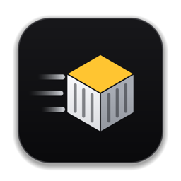
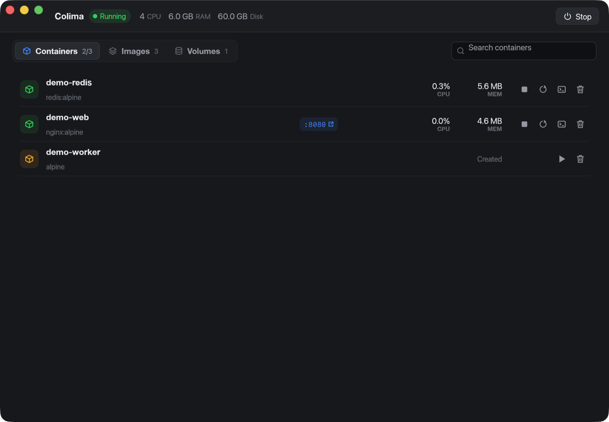
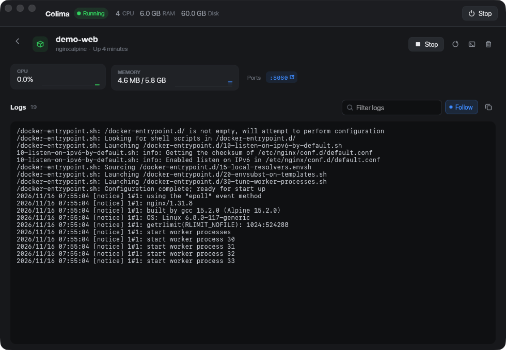

<p align="center">
  
</p>

<h1 align="center">Colima GUI</h1>

<p align="center">
  A small, fast, native-feeling macOS window for <a href="https://github.com/abiosoft/colima">Colima</a> —
  see and manage your containers without bringing Docker Desktop back.
</p>



## Features

- **Colima status at a glance** — running/stopped, CPU, RAM, disk; start and stop the VM.
- **Containers** — grouped by Compose project, live CPU / memory, published ports that open in your browser,
  start / stop / restart / delete, and a one-click shell in Terminal.
- **Container detail** — streaming logs with filter, follow and copy; CPU and memory sparklines.
- **Images & volumes** — sizes, age, "in use" markers, delete, and one-click clean-up of dangling images / unused volumes.
- **Menu bar icon** — the app keeps running in the menu bar when you close the window.
- **Guided setup** — if Colima isn't installed yet, the app shows what's missing and installs it with Homebrew.
- **Light** — a single Rust binary (egui), no WebView, no background daemon of its own.



## Install

1. Download `Colima-GUI-<version>-macos-universal.dmg` from the
   [latest release](https://github.com/cuong95nddev/colima-gui/releases/latest) (Apple Silicon and Intel).
2. Open it and drag **Colima GUI** onto **Applications**. The app is signed and notarized by Apple.

Requires macOS 11 or later. Colima itself is installed with `brew install colima docker`
(the app offers to do this for you on first launch).

## Keyboard shortcuts

| Shortcut | Action |
| --- | --- |
| <kbd>⌘</kbd> <kbd>1</kbd> / <kbd>2</kbd> / <kbd>3</kbd> | Containers / Images / Volumes |
| <kbd>⌘</kbd> <kbd>F</kbd> | Search |
| <kbd>⌘</kbd> <kbd>R</kbd> | Refresh |
| <kbd>⌘</kbd> <kbd>W</kbd> | Hide window (keeps running in the menu bar) |
| <kbd>Esc</kbd> | Back / clear search |

## Build from source

```sh
cargo run --release          # run it
scripts/install.sh           # build "Colima GUI.app" and copy it to /Applications
UNIVERSAL=1 scripts/bundle.sh  # universal (arm64 + x86_64) bundle in target/bundle/
scripts/release.sh             # universal DMG in dist/
```

The app talks to Docker through `~/.colima/default/docker.sock` (or `DOCKER_HOST`) and to Colima through its CLI.

## Releasing

Bump `version` in `Cargo.toml`, then push a matching tag (`v0.1.0`). The
[Release workflow](.github/workflows/release.yml) builds a universal app, signs it with a
Developer ID, notarizes and staples the app and the DMG, and publishes a GitHub release.

It needs these repository secrets (Settings ▸ Secrets and variables ▸ Actions):

| Secret | Value |
| --- | --- |
| `MACOS_CERT_P12` | Developer ID Application certificate + private key, exported as .p12, base64: `base64 -i cert.p12 \| pbcopy` |
| `MACOS_CERT_PASSWORD` | the .p12 export password |
| `MACOS_SIGN_ID` | the identity name, e.g. `Developer ID Application: Name (TEAMID)` |
| `NOTARY_KEY` | App Store Connect API key (.p8), base64: `base64 -i AuthKey_XXXX.p8 \| pbcopy` |
| `NOTARY_KEY_ID` | the API key's ID (10 characters) |
| `NOTARY_ISSUER` | the issuer ID (team keys only) |

Locally, `COLIMA_SIGN_ID=… COLIMA_NOTARY_PROFILE=… scripts/release.sh` does the same.
